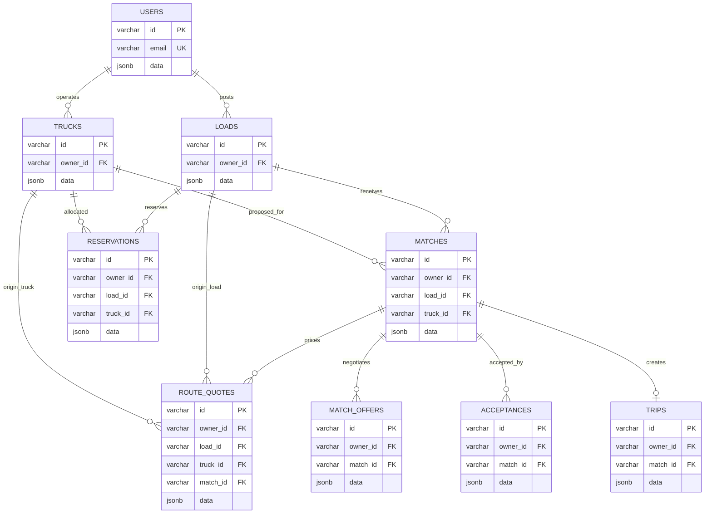
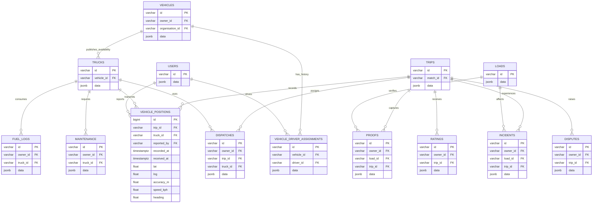
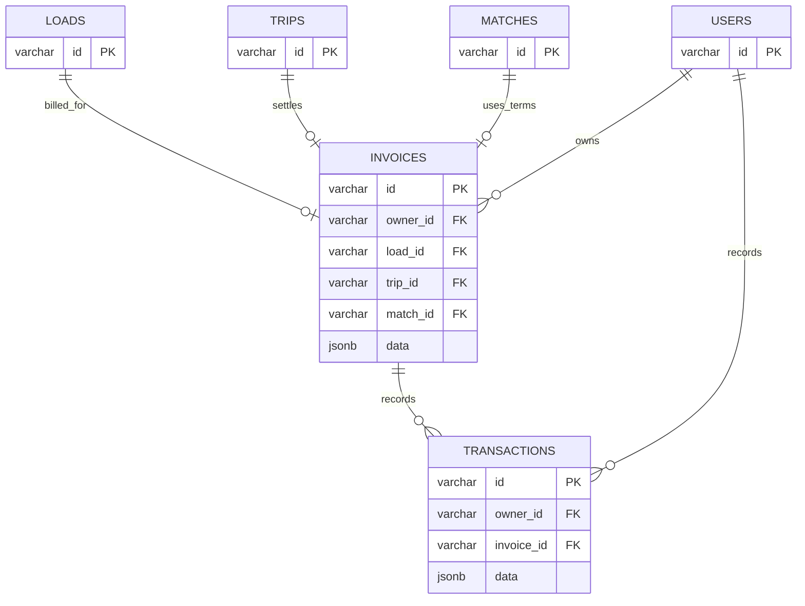
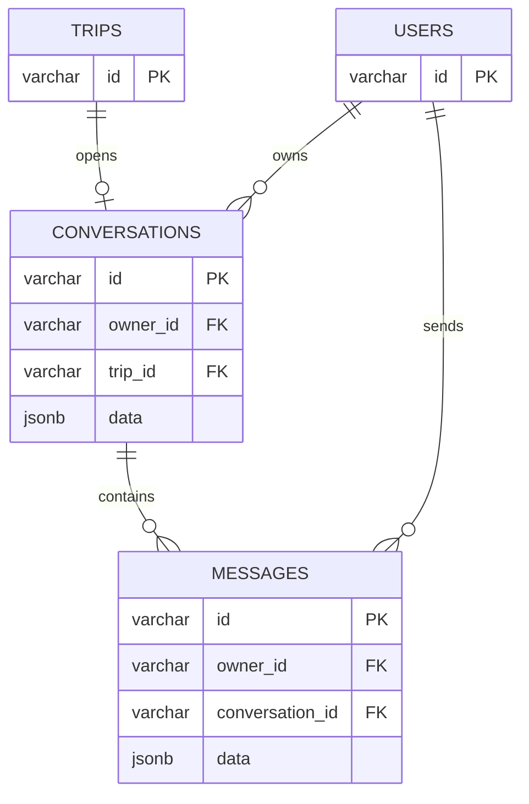

# TAMP Entity Relationship Diagram

**System:** Transport and Asset Matching Platform (TAMP)  
**Database:** PostgreSQL  
**Document status:** Current implementation as of 21 October 2026  
**Schema sources:** `tamp_backend/app/db/models/__init__.py`, Alembic migrations, backend services, and frontend domain contracts

## 1. Purpose and scope

This document describes the database currently used by TAMP. It covers identity and access, freight matching, trip execution, fleet operations, finance, messaging, notifications, file storage, auditing, and webhook delivery.

TAMP uses a hybrid relational/document design:

- Frequently joined identifiers are normal PostgreSQL columns with foreign keys and indexes.
- Each business table also has a `data` JSONB document containing its complete API representation.
- `owner_id` identifies the user that owns or created a record. It is nullable for system-created records.
- Some relationships exist only as identifiers inside JSONB. Those are marked **logical** and are not enforced by a database foreign key.

## 2. Notation

| Marker               | Meaning                                                                    |
| -------------------- | -------------------------------------------------------------------------- |
| `PK`                 | Primary key                                                                |
| `FK`                 | PostgreSQL foreign key                                                     |
| `UK`                 | Unique key or unique index                                                 |
| `JSONB`              | Nested business document stored in PostgreSQL                              |
| Logical relationship | Identifier stored inside `data`, without a physical foreign-key constraint |
| `                    |                                                                            | --o{` | One parent can have zero or many children |
| `                    |                                                                            | --o   | `                                         | One parent can have zero or one child |

## 3. Identity and platform services

```mermaid
erDiagram
    USERS ||--o{ SESSIONS : authenticates
    USERS ||--o{ ORGANISATION_MEMBERSHIPS : joins
    ORGANISATIONS ||--o{ ORGANISATION_MEMBERSHIPS : contains
    USERS ||--o{ USER_ROLES : receives
    ORGANISATIONS ||--o{ USER_ROLES : scopes
    ROLES ||--o{ USER_ROLES : assigned_as
    ROLES ||--o{ ROLE_PERMISSIONS : grants
    PERMISSIONS ||--o{ ROLE_PERMISSIONS : included_in
    USERS ||--o{ NOTIFICATIONS : receives
    USERS ||--o{ UPLOADS : owns
    USERS ||--o{ AUDIT : performs
    USERS ||--o{ WEBHOOKS : configures
    USERS ||--o{ DELIVERIES : owns

    USERS {
        varchar id PK
        varchar email UK
        varchar password_hash
        jsonb data
        jsonb onboarding
    }
    SESSIONS {
        varchar token PK
        varchar user_id FK
        varchar active_organisation_id FK
        timestamptz expires
    }
    ORGANISATIONS {
        varchar id PK
        varchar name
        varchar type
        varchar verification
        jsonb data
        timestamptz created_at
    }
    ORGANISATION_MEMBERSHIPS {
        varchar id PK
        varchar organisation_id FK
        varchar user_id FK
        varchar status
        boolean is_primary
        timestamptz created_at
    }
    ROLES {
        varchar id PK
        varchar name UK
        varchar scope
        varchar description
        boolean system
    }
    PERMISSIONS {
        varchar code PK
        varchar description
    }
    ROLE_PERMISSIONS {
        varchar role_id PK, FK
        varchar permission_code PK, FK
    }
    USER_ROLES {
        varchar id PK
        varchar user_id FK
        varchar role_id FK
        varchar organisation_id FK
        varchar assigned_by FK
        timestamptz created_at
    }
    EMAIL_CODES {
        varchar key PK
        varchar digest
        timestamptz expires
        integer attempts
        varchar target
    }
    RATE_BUCKETS {
        varchar key PK
        integer count
        timestamptz expires
    }
    NOTIFICATIONS {
        varchar id PK
        varchar owner_id FK
        jsonb data
    }
    UPLOADS {
        varchar id PK
        varchar owner_id FK
        jsonb data
    }
    AUDIT {
        varchar id PK
        varchar owner_id FK
        jsonb data
    }
    WEBHOOKS {
        varchar id PK
        varchar owner_id FK
        jsonb data
    }
    DELIVERIES {
        varchar id PK
        varchar owner_id FK
        jsonb data
    }
```

`user_roles` and `role_permissions` are authoritative for access control. Built-in roles cover freight owners, transporters, drivers, platform administrators, and the system super user. `users.data.role` remains temporarily for frontend routing compatibility. The bootstrap administrator is persisted as `system_super_user` and exposed to the frontend as `ADMIN`.

`email_codes` and `rate_buckets` are infrastructure tables and do not reference a party directly. Webhook delivery records contain a logical `endpointId` reference to `webhooks.id` inside JSONB.

## 4. Freight marketplace and agreement lifecycle

Key JSONB fields:

| Entity                     | Representative fields in `data`                                                                                      |
| -------------------------- | -------------------------------------------------------------------------------------------------------------------- |
| `loads`                    | `ownerId`, cargo totals, compatibility `origin`/`destination`, ordered `stops`, route distance, target rate, status  |
| `vehicles`                 | Permanent registration, VIN, make/model/year, body and capacity, compliance files, verification and lifecycle status |
| `vehicleDriverAssignments` | Vehicle, driver, assigning user, active/ended status, start and end timestamps                                       |
| `trucks`                   | `vehicleId`, current `driverId`, location, availability window, preferred lanes and marketplace status               |
| `matches`                  | `loadId`, `truckPostingId`, score and breakdown, status, agreed rate, active offer, expiry                           |
| `route_quotes`             | Route geometry, distance, duration, provider, pricing basis, `loadId`, `truckId`, `matchId`                          |
| `match_offers`             | Revision, terms hash, rate, status, proposer, expiry                                                                 |
| `acceptances`              | Party type, accepting user, offer revision, terms hash, timestamp, IP address                                        |
| `reservations`             | `loadId`, `truckId`, `transporterId`, reservation status and timestamp                                               |
| `trips`                    | `matchId`, status, current stop ID/index, timeline, driver, progress, ETA, current-stop geofence, incidents          |

Database constraints enforce one active accepted/confirmed match per load, one offer per match revision, one trip per match, and one active reservation per load.

Each load's `stops` array is the ordered consignment plan. A stop contains a stable ID, sequence, `PICKUP` or `DROPOFF` kind, geocoded place, service window, optional contact and instructions, cargo quantity, operational status, arrival/completion timestamps, and its proof ID. The first and last stops are mirrored into `origin`, `destination`, `pickupWindow`, and `deliveryBy` for compatibility with marketplace queries. Existing direct loads are migrated into one pickup and one drop-off stop.

## 5. Trip execution and fleet operations

The following operational associations are logical JSONB relationships:

- `dispatches.data.driverId` → `users.id`
- `trucks.vehicle_id` → `vehicles.id`
- `vehicleDriverAssignments.driver_id` → `users.id`
- `incidents.data.truckId` → `trucks.id`
- Rating `raterId` and `rateeId` → `users.id`
- Dispute `raisedById` → `users.id`
- Proof capture user and recipient information are stored in the proof document; `proofs.data.stopId` binds each proof to its exact consignment stop.

Only one rating is allowed for each `(owner_id, trip_id)` pair. Vehicle positions use normal typed columns because they are high-volume, ordered telemetry rather than general JSONB records.

## 6. Finance

Invoice JSONB includes the freight owner and carrier IDs, ZAR totals, VAT, platform fee, carrier payout, line items, due date, payment state, and payout state. Transaction documents record payments, payouts, and voids together with the administrator who recorded the action.

## 7. Trip messaging

Conversation participants are stored logically as `ownerId`, `carrierId`, and optional `driverId`. Message JSONB contains `senderId`, `senderRole`, `kind`, text or attachment metadata, creation time, and the `readBy` user ID list. System messages have no sender party.

## 8. Physical table catalogue

All general business tables use `id VARCHAR(80)`, nullable `owner_id`, nullable `organisation_id`, and `data JSONB`. The active organisation is stored on the authenticated session and new records inherit that scope. The table below lists their additional relational columns.

| Table                      | Additional relational columns                                        | Main responsibility                                                               |
| -------------------------- | -------------------------------------------------------------------- | --------------------------------------------------------------------------------- |
| `users`                    | `email`, `password_hash`, `onboarding`                               | Login identities, profiles, verification, onboarding                              |
| `organisations`            | `name`, `type`, `verification`, `created_at`                         | Freight companies, carriers, and other business accounts                          |
| `organisation_memberships` | `organisation_id`, `user_id`, `status`, `is_primary`, `created_at`   | Many-to-many organisation membership                                              |
| `roles`                    | `name`, `scope`, `description`, `system`                             | Platform and organisation role definitions                                        |
| `permissions`              | `code`, `description`                                                | Individual backend capabilities                                                   |
| `role_permissions`         | `role_id`, `permission_code`                                         | Permissions granted by each role                                                  |
| `user_roles`               | `user_id`, `role_id`, `organisation_id`, `assigned_by`, `created_at` | Global or organisation-scoped role assignments                                    |
| `sessions`                 | `user_id`, `active_organisation_id`, `expires`                       | Hashed authentication sessions and active organisation context                    |
| `email_codes`              | `digest`, `expires`, `attempts`, `target`                            | Email verification and password recovery codes                                    |
| `rate_buckets`             | `count`, `expires`                                                   | Persistent request-rate counters                                                  |
| `loads`                    | —                                                                    | Freight requirements and ordered multi-stop consignment route                     |
| `vehicles`                 | —                                                                    | Permanent fleet assets, identity, capacity, documents, verification and lifecycle |
| `vehicleDriverAssignments` | `vehicle_id`, `driver_id`                                            | Auditable driver assignment history                                               |
| `trucks`                   | `vehicle_id`                                                         | Marketplace availability posting, location, lanes and current driver              |
| `matches`                  | `load_id`, `truck_id`                                                | Scored load/truck candidates and agreement state                                  |
| `route_quotes`             | `load_id`, `truck_id`, `match_id`                                    | Route and price evidence for an offer                                             |
| `match_offers`             | `match_id`                                                           | Versioned commercial offers                                                       |
| `acceptances`              | `match_id`                                                           | Immutable party acceptance evidence                                               |
| `reservations`             | `load_id`, `truck_id`                                                | Temporary capacity reservation                                                    |
| `trips`                    | `match_id`                                                           | Authoritative delivery lifecycle                                                  |
| `vehicle_positions`        | Typed telemetry columns                                              | Live and historical GPS telemetry                                                 |
| `dispatches`               | `trip_id`, `truck_id`                                                | Driver assignment and response workflow                                           |
| `proofs`                   | `load_id`, `trip_id`                                                 | Pickup and delivery proof                                                         |
| `incidents`                | `load_id`, `trip_id`                                                 | Operational incident workflow                                                     |
| `ratings`                  | `trip_id`                                                            | Post-trip participant ratings                                                     |
| `disputes`                 | `trip_id`                                                            | Post-trip dispute workflow                                                        |
| `fuelLogs`                 | `truck_id`                                                           | Fuel cost and odometer entries                                                    |
| `maintenance`              | `truck_id`                                                           | Service, repair, inspection, and licence tasks                                    |
| `invoices`                 | `load_id`, `trip_id`, `match_id`                                     | Freight charge, VAT, fee, and payout calculation                                  |
| `transactions`             | `invoice_id`                                                         | Payment, payout, and void ledger entries                                          |
| `conversations`            | `trip_id`                                                            | One participant conversation per trip                                             |
| `messages`                 | `conversation_id`                                                    | User and system trip messages                                                     |
| `notifications`            | —                                                                    | Per-user application notifications                                                |
| `uploads`                  | —                                                                    | Private file metadata and ownership                                               |
| `audit`                    | —                                                                    | Immutable business activity history                                               |
| `webhooks`                 | —                                                                    | Outbound webhook subscriptions                                                    |
| `deliveries`               | —                                                                    | Webhook attempts and retry state                                                  |

## 9. Important integrity constraints

| Constraint                        | Rule                                                   |
| --------------------------------- | ------------------------------------------------------ |
| `users.email`                     | Unique account email                                   |
| `one_live_match_per_load`         | At most one `ACCEPTED` or `CONFIRMED` match for a load |
| `one_offer_revision_per_match`    | Offer revision is unique within a match                |
| `one_active_trip_per_truck_match` | A match creates at most one trip                       |
| `one_reservation_per_load`        | At most one `RESERVED` reservation for a load          |
| `one_rating_per_party_trip`       | A user can rate a trip once                            |
| `invoices.trip_id`                | One invoice per trip                                   |
| `conversations.trip_id`           | One conversation per trip                              |

## 10. Current design considerations

The JSONB model keeps the API contract flexible and allows nested values such as addresses, matching score components, timelines, geofences, and invoice line items to remain atomic documents. The relational columns enforce the most important lifecycle joins and support indexed access.

Several user and subject references remain inside JSONB. PostgreSQL cannot enforce those references or cascade changes. As the system grows, fields frequently used for joins, reporting, retention, or access control should be promoted to typed columns with foreign keys. The strongest candidates are truck driver, dispatch driver, message sender, invoice carrier, rating participants, incident truck, webhook endpoint, and notification subject.

The legacy `users.data.role` value and public `Party` TypeScript alias remain during the compatibility period. Authorisation is already resolved from `user_roles`, `roles`, and `role_permissions`; later API revisions can remove the legacy naming after all clients have migrated to `users.*`.

Table naming should also be normalized in a future migration: `fuelLogs` is the only camel-case table name, while the rest use lowercase or snake case.
